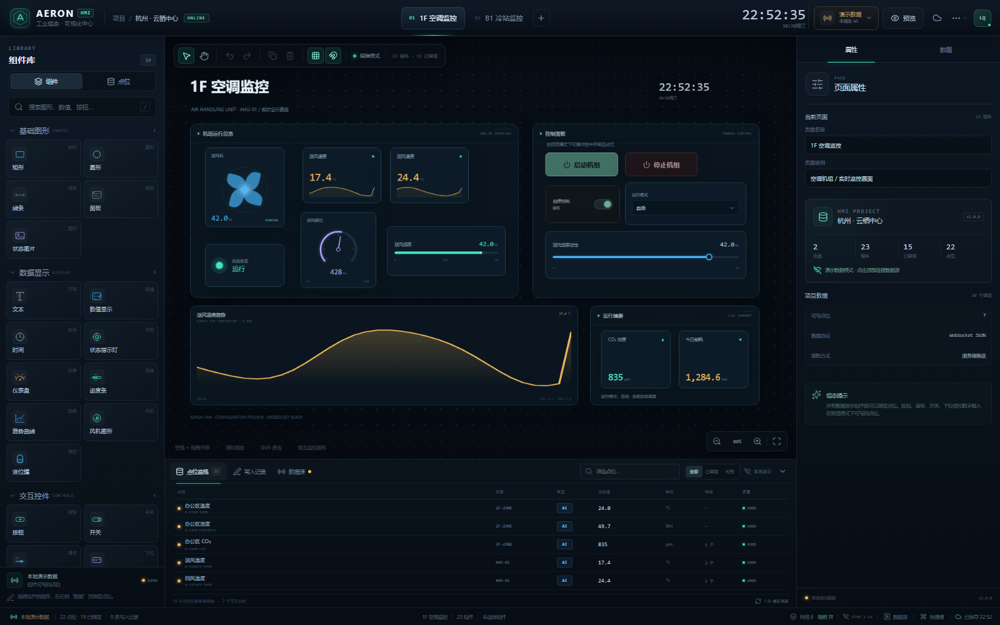
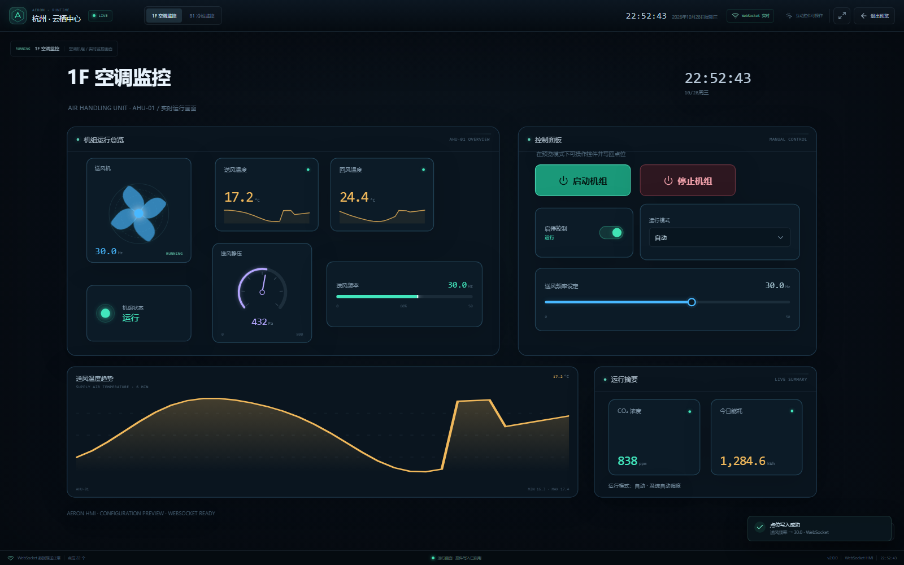
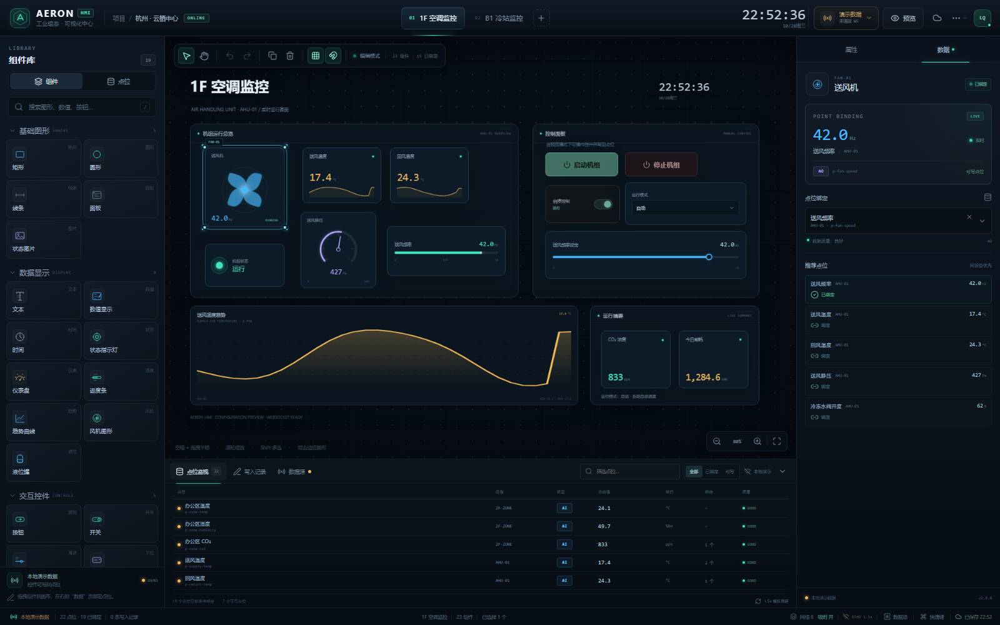
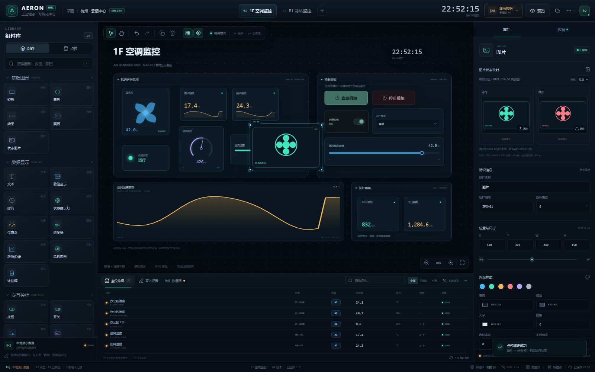
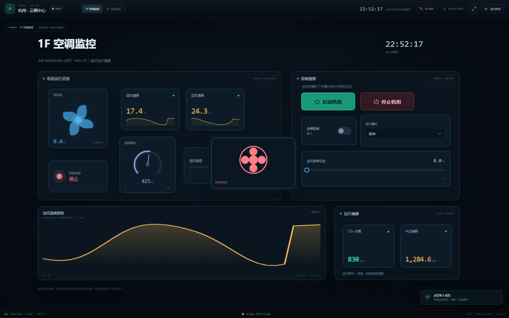
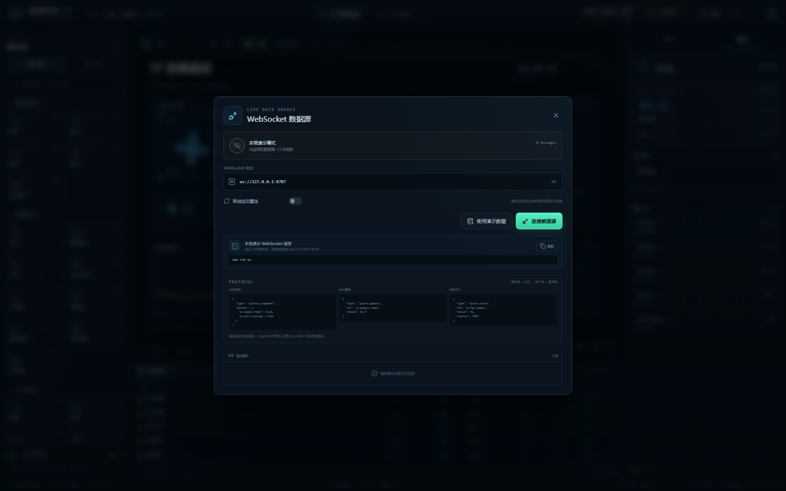
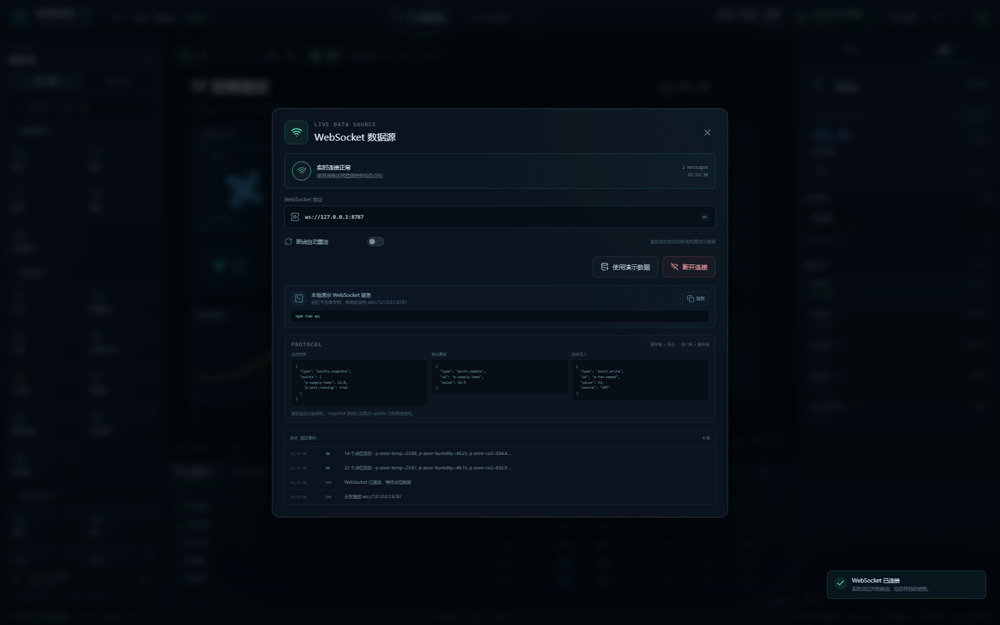
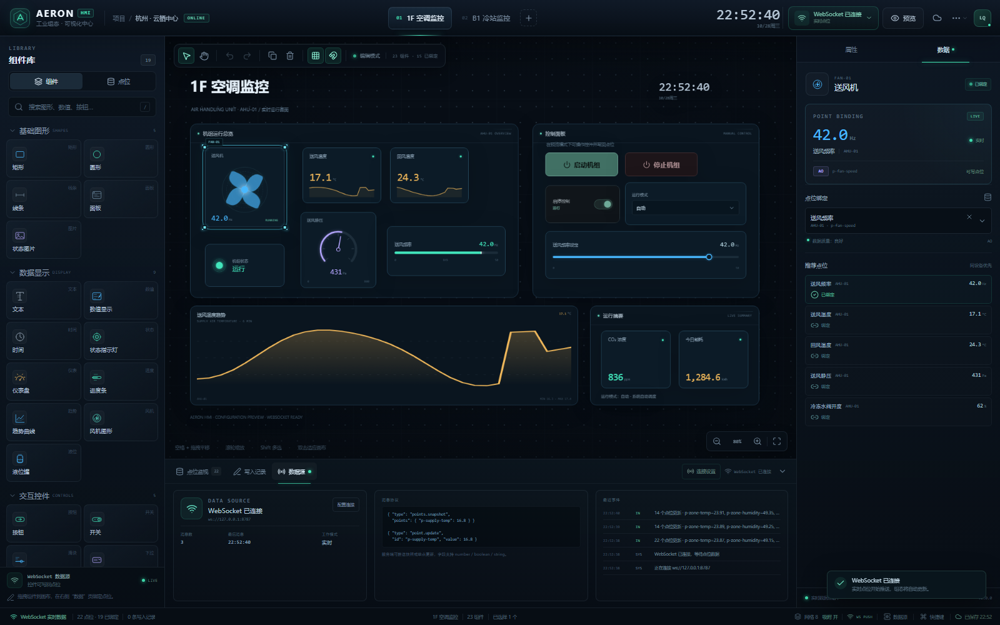

# AERON HMI · 工业组态设计器

基于 **React + TypeScript + Vite** 的可视化 HMI 组态工具。使用图形、文字、数值、按钮、滑块、下拉框等通用组件搭建监控画面，所有组件都可以绑定点位，并通过 **WebSocket** 实时刷新数值、图形状态和交互控件。

没有管线连接逻辑，专注“画面搭建 + 点位绑定 + 实时数据 + 控件写回”。



## 快速开始

```bash
npm install
npm run ws       # 终端 1：启动本地模拟 WebSocket 点位服务
npm run dev      # 终端 2：启动组态编辑器
```

打开 `http://127.0.0.1:5173`。编辑器默认使用内置演示数据，点击顶部“演示数据”连接本地 WebSocket：

- WebSocket 地址：`ws://127.0.0.1:8787`
- 服务端每 1.5 秒推送一次模拟量变化
- 按钮 / 滑块 / 开关 / 下拉框 / 数字输入通过 `point.write` 写回
- 收发消息、连接状态和写入记录都会显示在界面中

生产构建：

```bash
npm run build
npm run preview
```

## 组件库

### 基础图形

- 矩形、圆形、线条、面板、状态图片
- 图形可以绑定点位，并通过“数据驱动外观”控制**显示/隐藏**或**阈值变色**
- 状态图片支持本地上传多张图片，根据点位状态自动切换

### 数据显示

- 文本：支持 `{value}`、`{unit}`、`{name}`、`{device}` 动态模板
- 数值显示：实时数字、单位、数据质量、迷你趋势
- 系统时间
- 状态指示灯：按布尔点位显示运行/停止颜色和文本
- 仪表盘：圆弧刻度、实时指针
- 进度条：数值区间百分比
- 趋势曲线：使用点位历史数据绘制
- 风机图形：点位值驱动旋转速度
- 液位罐：点位值驱动液位高度

### 交互控件

- 按钮：写入指定值，或切换当前值
- 开关：切换布尔 / 枚举点位
- 滑块：拖动写入数值
- 下拉框：从点位枚举选项写入
- 数字输入：输入并写回数值

所有控件在编辑模式下只参与选中和拖动；切换到“预览”后才会真正下发写入，避免编辑误操作。



## WebSocket 数据协议

### 服务端推送点位快照

```json
{
  "type": "points.snapshot",
  "points": {
    "p-supply-temp": 16.8,
    "p-unit-running": true
  }
}
```

### 服务端推送增量更新

```json
{
  "type": "points.update",
  "points": {
    "p-supply-temp": 16.9,
    "p-mode": "auto"
  }
}
```

也兼容：

```json
{ "type": "point.update", "id": "p-supply-temp", "value": 16.9 }
```

以及直接的点位对象映射：

```json
{ "p-supply-temp": 16.9, "p-unit-running": true }
```

### 客户端写入

```json
{
  "type": "point.write",
  "id": "p-fan-speed",
  "value": 42,
  "source": "送风频率设定",
  "ts": 1761645000000
}
```

服务端应返回确认或直接广播更新。演示服务会回传 `point.write.ack` 和 `points.update`。

## 点位绑定

1. 在画布中选中一个组件
2. 打开右侧“数据”页
3. 选择点位，或从推荐点位中点击“绑定”
4. 显示类组件立即显示实时值并跟随推送更新
5. 控件类组件还需在“属性 → 组件设置”中配置写入值或操作方式

绑定关系会保存在项目 JSON 中。



## 状态图片映射

“状态图片”组件支持上传图片，并根据绑定点位自动切换：

| 点位类型 | 图片配置 |
| --- | --- |
| 布尔 DI / DO | 两张：TRUE 一张，FALSE 一张 |
| 数字 AI / AO | 多段区间，每段一张，例如 `0–20`、`20–50` |
| 枚举 STRING | 每个枚举值一张，例如 `0`、`1`、`auto` |
| 未绑定 | 只上传一张默认图片 |



- 数字区间采用左闭右开匹配，区间重叠时会显示提示并按顺序优先匹配
- 支持 `cover / contain` 两种图片填充方式
- 上传后自动压缩到最大 1400 px，减少本地存储体积
- 图片以 Data URL 保存在项目中，导出 JSON 会一并携带
- 布尔、数字、枚举状态切换均由实时点位驱动

运行预览中切换运行状态，图片会自动替换：



## 数据控制台

底部工作区包含：

- **点位监视**：全部点位、当前值、质量、绑定组件数量，随 WebSocket 或演示数据实时刷新
- **写入记录**：记录每次控件写入的点位、值、来源、通道（WebSocket / 演示）与结果
- **数据源**：连接状态、消息数量、最后消息时间、协议示例、最近事件

## 数据源连接



连接成功后的实时状态：



底部“数据源”页同步显示消息数量、最后消息、协议与事件流：



- 点击顶栏的“演示数据 / WebSocket 已连接”打开连接面板
- 支持断线自动重连
- 连接成功后自动停用演示数据
- 断线后可以一键切回演示数据
- 连接地址保存在 `localStorage`

## 操作

| 操作 | 快捷键 |
| --- | --- |
| 选择工具 | `V` |
| 平移工具 | `H` |
| 运行预览 | `P` |
| 撤销 / 重做 | `Ctrl/Cmd + Z` / `Ctrl/Cmd + Shift + Z` |
| 复制组件 | `Ctrl/Cmd + D` |
| 保存项目 | `Ctrl/Cmd + S` |
| 导出项目 | `Ctrl/Cmd + E` |
| 删除组件 | `Delete` |
| 微调位置 | 方向键 |
| 快速微调 | `Shift + 方向键` |
| 平移画布 | 空格 + 拖拽 |
| 缩放画布 | 滚轮 |
| 适应视图 | 双击画布空白处 |

编辑器的撤销重做、吸附、拖动事务、多选对齐、图层排序和本地自动保存均已实现。

## 项目结构

```text
src/
  App.tsx                  项目状态、编辑操作、撤销重做、导入导出
  types.ts                 组件、点位、页面、WebSocket 类型
  hooks/
    useLiveData.ts         WebSocket 连接、演示数据、点位写入与消息解析
  data/
    components.ts          19 种组件模板
    initialProject.ts      示例页面、点位与绑定关系
  lib/
    graph.ts               坐标、吸附、点位格式化
    imageRules.ts          按布尔 / 区间 / 枚举生成与解析图片映射
    imageUpload.ts         图片校验、压缩与 Data URL 转换
  components/
    Header.tsx             页面页签、数据源状态、保存与预览
    LibraryPanel.tsx       组件库 / 点位库
    Canvas.tsx             画布、拖拽、缩放、框选、缩放适配
    WidgetRenderer.tsx     所有组件的渲染与交互
    ImageStateEditor.tsx   状态图片上传、区间 / 枚举映射编辑
    Inspector.tsx          属性、样式、下拉选项、点位绑定
    BottomPanel.tsx        点位监视、写入记录、数据源
    PreviewMode.tsx        运行画面
    ConnectionModal.tsx    WebSocket 配置与协议说明
    PaletteIcon.tsx        组件库图标
  styles.css               基础工作台样式
  styles-v2.css            组件、数据台、连接面板与运行画面样式
scripts/
  mock-ws-server.mjs       本地 WebSocket 点位模拟服务
  smoke.mjs                端到端交互测试
  screenshot.mjs           Playwright 截图
```

## 验证

先启动 WebSocket 服务与生产预览：

```bash
npm run ws
npm run preview
```

再执行：

```bash
npm run smoke
npm run smoke:images
```

冒烟测试覆盖：

- 图元无端口、无连线
- 拖动添加通用组件
- 面板层级与子组件遮挡
- 点位绑定与实时值
- WebSocket 连接、快照接收和动态推送
- 按钮、开关、滑块、下拉框写回
- 写入记录
- 新建页面与撤销
- 状态图片上传、布尔双状态、数字区间、枚举值映射
- 图片随布尔点位切换
- 保存、刷新恢复、JSON 导出
- 浏览器控制台无错误

> 本项目默认使用内置演示数据，连接真实 WebSocket 服务后由服务端推送驱动。页面和绑定保存在浏览器 `localStorage`，项目文件可导入/导出。
